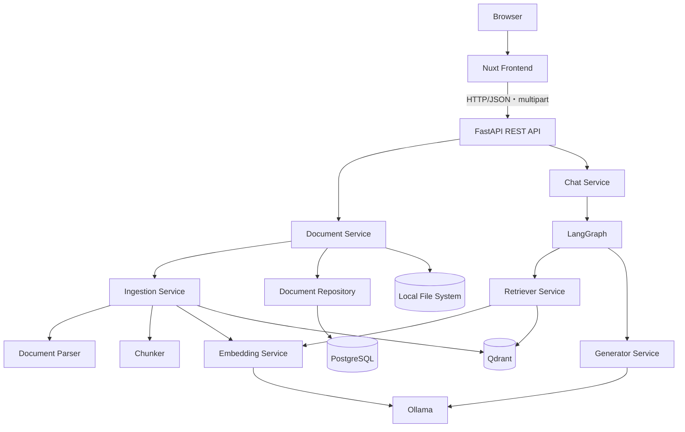
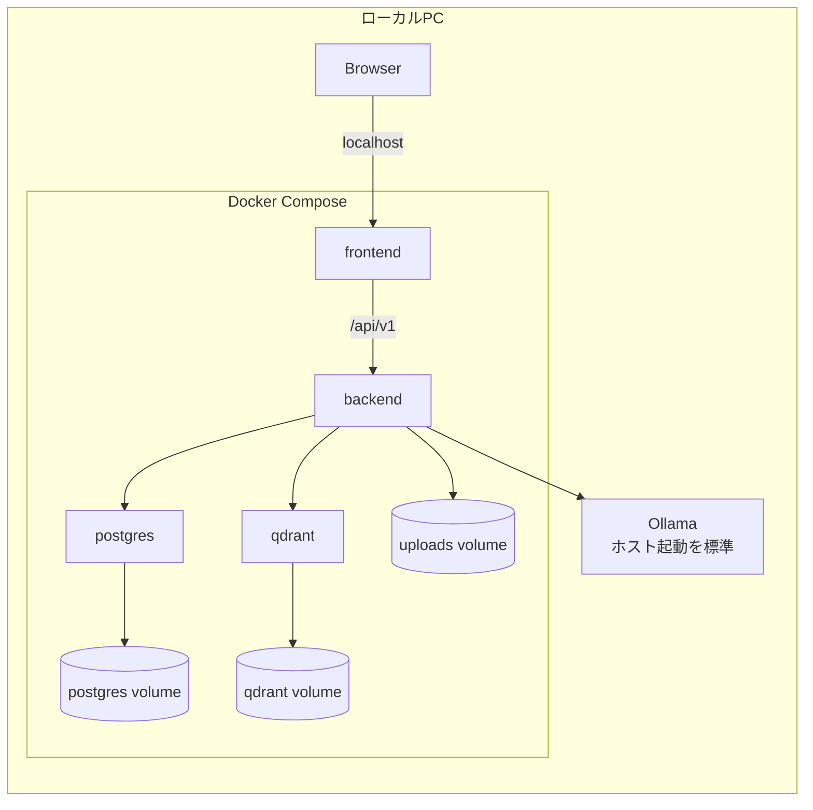

# 3. アーキテクチャ

## 3.1 システム構成



## 3.2 配置構成



- 公開ポートは原則としてループバックアドレスへバインドする。
- FrontendからBackendへの接続先、BackendからQdrant・Ollamaへの接続先は環境変数で切り替える。
- APIはステートレスに保ち、永続データはPostgreSQL、Qdrant、ローカルファイルに分離する。
- MVPでは不必要なマイクロサービス化を避け、Backend内を責務別モジュールとして分割する。

## 3.3 Backendレイヤー

依存方向は外側から内側へ向ける。

```text
API Routes / Graph Nodes
          ↓
Application Services
          ↓
Repository・Gateway Interfaces
          ↓
PostgreSQL・Qdrant・Ollama・File System Adapters
```

LangGraph Nodeは外部システムへ直接アクセスせず、Retriever ServiceまたはGenerator Serviceを呼び出す。FastAPI Routeもビジネス処理を持たず、入力検証、Service呼び出し、HTTPレスポンス変換に限定する。
