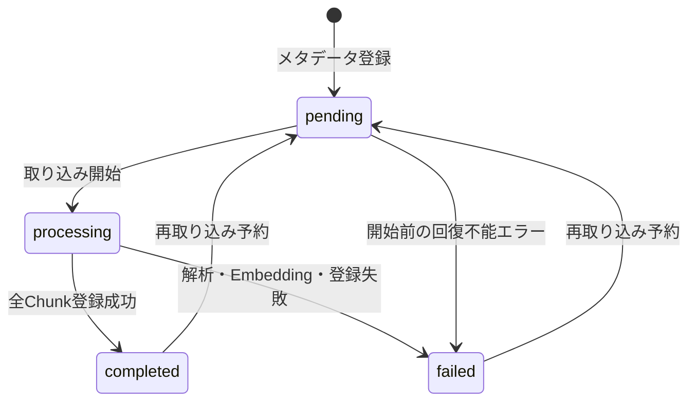

# 8. DB設計

## 8.1 PostgreSQL: `documents`

| Column | PostgreSQL Type | Null | 制約・説明 |
|---|---|---|---|
| `id` | UUID | No | PK |
| `filename` | VARCHAR(255) | No | 表示用の元ファイル名 |
| `file_path` | TEXT | No | アプリ管理領域内の保存先。APIには露出しない |
| `file_type` | VARCHAR(16) | No | `pdf` / `md` / `txt` のCHECK制約 |
| `content_hash` | CHAR(64) | No | 小文字16進SHA-256、UNIQUE |
| `status` | VARCHAR(16) | No | `pending` / `processing` / `completed` / `failed` のCHECK制約 |
| `chunk_count` | INTEGER | No | 既定値0、0以上のCHECK制約 |
| `error_message` | TEXT | Yes | 取り込み失敗理由。成功時はNULL |
| `created_at` | TIMESTAMPTZ | No | UTC、作成時刻 |
| `updated_at` | TIMESTAMPTZ | No | UTC、更新時刻 |

Index:

- `UNIQUE CONSTRAINT uq_documents_content_hash (content_hash)`：重複文書防止と同時登録時の競合制御
- `INDEX ix_documents_status (status)`：状態絞り込み
- `INDEX ix_documents_created_at (created_at DESC)`：一覧表示

DBの文字コードはUTF-8、タイムゾーンはUTCを基準とする。Schema変更はMigrationツールで管理し、アプリ起動時の暗黙的なテーブル再作成は行わない。文書登録時の重複判定は事前照会だけに依存せず、UNIQUE制約違反も捕捉して `409 Conflict` へ変換する。

状態遷移:



- `completed` への更新と同時に `chunk_count` を確定し、`error_message` をNULLへ戻す。
- `failed` への更新時は、ユーザーが原因と対処を判断できる範囲のエラー要約を保存する。
- アプリケーション起動時、長時間 `processing` のレコードは中断された可能性があるため `failed` として回復可能にする。

## 8.2 Qdrant: `document_chunks`

- Distance: Embeddingモデルが推奨する距離尺度。初期候補はCosine。
- Vector size: 設定されたEmbeddingモデルの出力次元と一致させる。
- 1 Point = 1 Chunk。
- Point IDは `document_id` と `chunk_index` から決定的に生成するUUIDとし、同じ文書の再取り込みで安定させる。

Payload:

```json
{
  "document_id": "document-uuid",
  "chunk_index": 0,
  "filename": "travel_policy.pdf",
  "text": "第5条 宿泊費…",
  "page": 3,
  "section": null
}
```

- `document_id` にPayload indexを作成し、削除・再取り込み時の絞り込みに利用する。
- `page` はPDFでは1始まりのページ番号、Markdown/TXTでは `null` とする。
- `section` は見出しを取得可能な場合のみ設定する。
- Embeddingモデルまたはベクトル次元を変更する場合、既存Collectionとの混在を禁止し、全件再取り込みまたは新Collectionへの移行を行う。

## 8.3 ファイル保存

```text
data/
├── uploads/
│   └── {document_id}/
│       └── original.{extension}
└── postgres/                 # PostgreSQLコンテナの永続化領域
```

元ファイル名を直接パスとして利用せず、文書UUID配下の固定名で保存する。許可された拡張子、MIMEの整合性、最大サイズを検証し、社内文書やDBをGit管理対象外とする。
