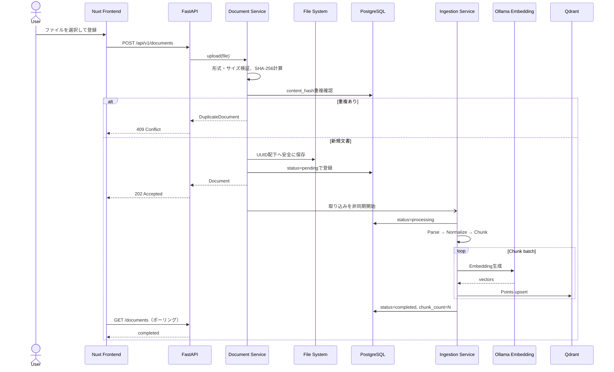
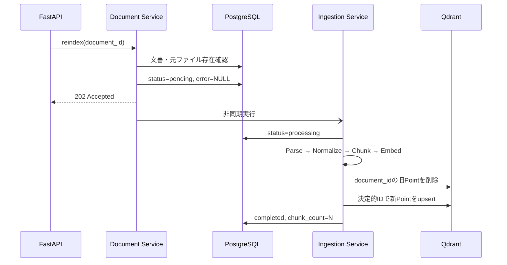

# 9. 文書取り込みフロー

## 9.1 登録シーケンス

## 9.2 処理規則

1. API受付中に形式、拡張子、MIME、サイズ、空ファイルを検証する。
2. ストリームとしてSHA-256を計算し、一時保存後に重複を判定する。
3. ファイル保存とメタデータ登録が片方だけ成功した場合は補償処理し、孤児ファイルを残さない。
4. 文書登録後は速やかに `202` を返し、取り込み本体を非同期で実行する。
5. Parser出力はページまたはセクション単位のメタデータを保持する。
6. 正規化では検索に不要な空白を整えるが、意味を変える加工は行わない。
7. Chunk SizeとOverlapは設定値とし、空Chunkは破棄する。
8. Embeddingは過負荷を避けるバッチ単位で生成する。
9. すべてのPoint登録後に文書を `completed` にする。
10. 途中失敗時は作成済みPointを文書IDで削除し、文書を `failed` にして原因を記録する。

## 9.3 再取り込み

新Chunkの生成に成功してから旧Pointを置換する順序を基本とする。MVPで一時Collection等による完全なアトミック置換を行わない場合、置換失敗時は文書を `failed` とし、再試行可能にする。決定的Point IDと文書単位削除により重複を防ぐ。

## 9.4 削除

削除はQdrantの関連Point、元ファイル、PostgreSQLメタデータの順に実行する。途中失敗時に「削除済み」と誤表示しないよう、PostgreSQLレコードは最後まで保持する。`processing` 中の削除は競合を避けるため `409` とするか、ジョブのキャンセル機構が実装された後に許可する。
