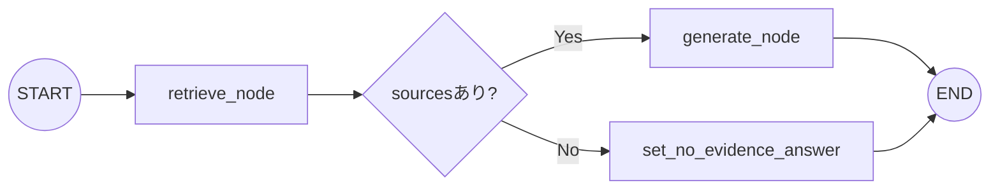

# 11. LangGraph設計

## 11.1 Graph



論理的には `START → retrieve → generate → END` を維持する。検索結果が空の場合、`generate_node` 内または条件分岐でLLMを呼び出さず、固定の回答不能メッセージを設定する。

## 11.2 State

```python
from typing import TypedDict


class Source(TypedDict):
    document_id: str
    chunk_id: str
    filename: str
    page: int | None
    section: str | None
    text: str
    score: float


class RAGState(TypedDict):
    question: str
    top_k: int
    sources: list[Source]
    answer: str
```

`top_k` はGraph実行中に必要なため初期Stateへ含める。モデル名は実行設定でありStateには持たせず、APIレスポンス構築時に設定から付与する。Stateは永続化せず、1リクエスト内だけで利用する。

## 11.3 Node責務

| Node | 入力 | 処理 | 出力 |
|---|---|---|---|
| `retrieve_node` | `question`, `top_k` | Retriever Service呼び出し | `sources` |
| `generate_node` | `question`, `sources` | Generator Service呼び出し。空なら回答不能メッセージ | `answer` |

NodeはDependency InjectionでServiceを受け取り、QdrantクライアントやOllamaクライアントを直接生成しない。これによりServiceをFakeへ差し替えてGraph単体テストを行える。
